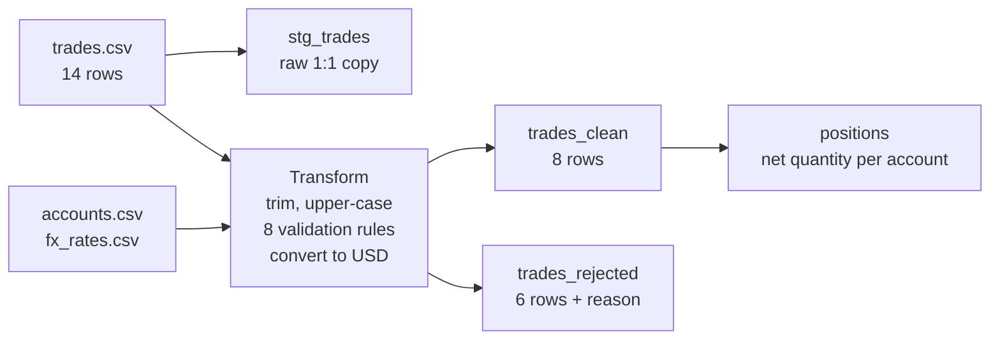

# ETL Testing Portfolio: trade data pipeline

[](https://github.com/dusan89srb/etl-testing-portfolio/actions/workflows/data-tests.yml)

A small ETL pipeline for fund trade data (CSV -> SQLite) and an automated test suite
that proves the data arriving in the warehouse is **complete, valid and correct**.

The focus of this project is the testing, not the pipeline: 42 automated tests in
pytest and SQL, a reviewed mapping specification, and mutation testing that proves
the tests actually catch bugs. Everything runs in GitHub Actions on every push.

## The scenario

A fund sends a daily file of trades (buys and sells of shares in USD, EUR and GBP).
The ETL cleans it, converts values to USD, rejects bad rows with a reason, and loads
clean trades and per-account positions into a warehouse. The test suite has to prove
that no row was lost, invented or calculated incorrectly on the way.

The source file contains deliberately planted defects: a duplicate trade, an unknown
account, a negative quantity, a currency without an FX rate, a missing ticker, an
invalid date, and a row with stray whitespace and lower-case codes that must be
cleaned, not rejected.



## What is tested (42 automated tests)

| Area | What it proves | File |
|---|---|---|
| Completeness | Every source row is either loaded or rejected, never lost or duplicated | `tests/test_completeness.py` |
| Schema | Columns, types and primary keys match the agreed contract | `tests/test_schema.py` |
| Data quality | Uniqueness, required values, valid ranges and formats, referential integrity | `tests/test_data_quality.py` |
| Source-to-target reconciliation | Column-by-column mapping, FX conversion, control totals | `tests/test_reconciliation.py` |
| Business rules | Positions match hand-calculated golden values; aggregates rebuild from detail | `tests/test_business_rules.py` |
| Rejections | Bad rows are rejected for the right reason and the original is kept for audit | `tests/test_rejections.py` |

Testing principles used throughout:

- **Independent test oracle.** Expected values come from the specification, hand
  calculation or SQL written separately from the ETL code, never from re-running the ETL.
- **Rule as a query.** Each data quality rule is a SQL query that returns the rows
  breaking it; an empty result means the rule holds (the same idea as dbt tests).
- **Counts are not enough.** Row counts are backed by key-level checks (`EXCEPT`,
  `INTERSECT`), because a lost row and a duplicated row cancel out in a count.
- **Tolerance for decimals.** Money values are compared with a tolerance, never `==`.

## Do the tests catch bugs? (mutation testing)

Each bug was injected into `etl/pipeline.py` on its own, the suite was run, and the
change was reverted.

| # | Injected bug | Result |
|---|---|---|
| 1 | De-duplication removed | Load rejected by the `PRIMARY KEY` constraint, all tests error |
| 2 | FX rate applied the wrong way | 4 tests fail (EUR/GBP notional, FX check, control total) |
| 3 | Normalization removed | 4 tests fail (lower-case row rejected as INVALID_SIDE) |
| 4 | SELL counted as BUY | 2 tests fail (golden positions, aggregate rebuild) |
| 5 | Rejected rows silently dropped | 9 tests fail (completeness, rejection reasons) |

Every injected bug was caught. Bug 2 is also committed on the
[`mutations-testing`](https://github.com/dusan89srb/etl-testing-portfolio/actions?query=branch%3Amutations-testing)
branch to show the CI pipeline failing on broken code, while `main` stays green.

## Specification and analysis

- [`docs/mapping.md`](docs/mapping.md): source-to-target mapping, rejection rules in
  order, control totals, and **open questions** raised for the analyst (duplicate
  handling, half-cent rounding in Python vs SQL, which FX rate applies).
- [`sql/exploration.sql`](sql/exploration.sql): manual data profiling done before
  automation (window functions for duplicates, anti-joins for orphans, date validation).

## Run it

```bash
python -m venv .venv
.venv\Scripts\activate              # Linux/Mac: source .venv/bin/activate
pip install -r requirements.txt
python -m etl.pipeline              # builds data/warehouse.db
pytest --html=reports/report.html --self-contained-html
```

In CI, every push and pull request runs the ETL and the full suite; JUnit XML and
HTML reports are kept as build artifacts, including when tests fail.

## Project structure

```text
etl-testing-portfolio/
├── data/source/          # source CSV files with planted defects
├── docs/                 # mapping specification, mutation testing notes
├── etl/pipeline.py       # the ETL under test
├── sql/exploration.sql   # manual data profiling queries
├── tests/                # pytest + SQL test suite
└── .github/workflows/    # GitHub Actions CI
```

## At larger scale

With millions of rows I would keep the same test design but move the work into the
database: control totals and row hashes per partition (for example per trade date)
instead of row-by-row comparison in Python, and detailed checks on samples.

## Tools

Python, pytest, pandas, SQLite (joins, CTEs, window functions, `EXCEPT`/`INTERSECT`),
GitHub Actions, pytest-html.

Built with AI-assisted coding (Claude Code) as a pair programmer. The test strategy,
mapping review, data profiling and mutation analysis are my own.
